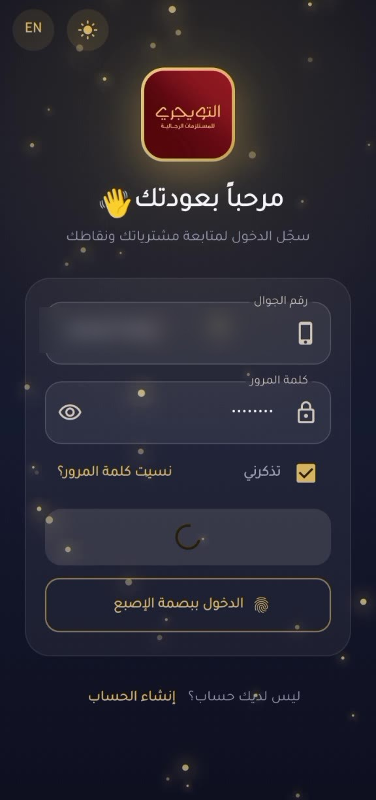
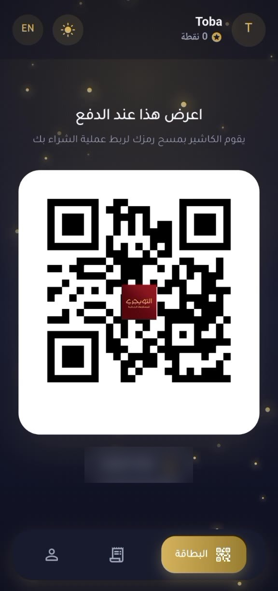
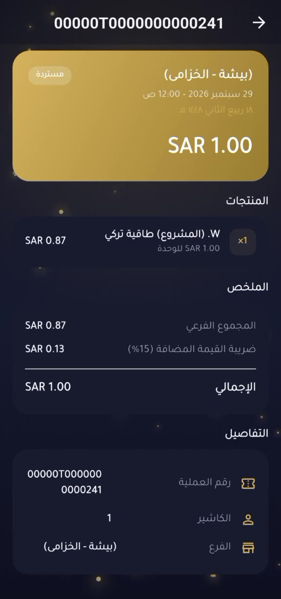
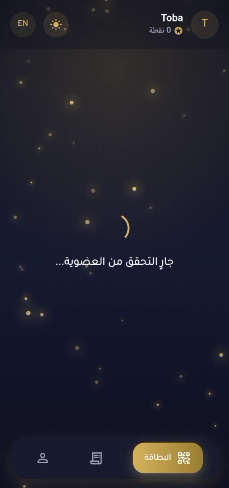
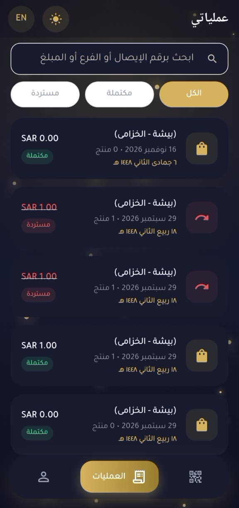
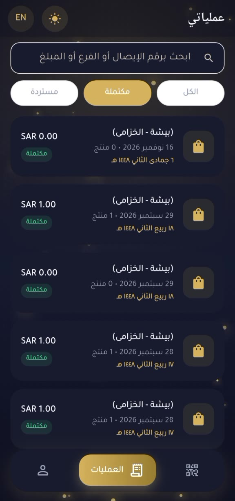
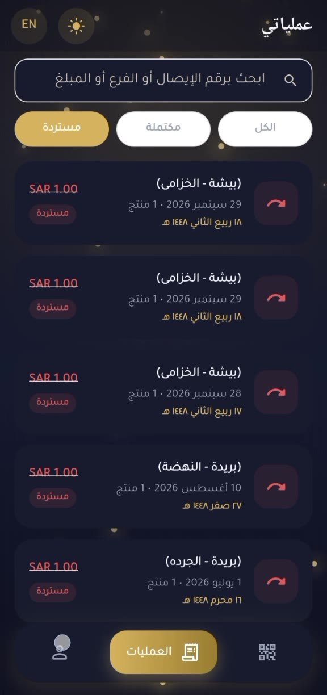

<!-- ═══════════════ HEADER ═══════════════ -->


<div align="center">


<br/>

**A customer loyalty wallet: show your card at the till, collect points, and see every purchase.**

[Overview](#-overview) · [Demo](#-video-demo) · [Features](#-features) · [Screenshots](#-screenshots) · [How it works](#%EF%B8%8F-how-it-works) · [Backend APIs](#-business-central-apis) · [Contact](#-contact)

</div>

---

## 💳 Overview

**Al Tuwijri Wallet** is the customer loyalty app of **Al Tuwijri for Men's Accessories**. It connects directly to the company's **Microsoft Dynamics 365 Business Central** and **LS Central** POS.

Customers sign in with their mobile number and show their **membership QR code** when they pay. The cashier scans it, and the purchase is linked to the customer's membership. The customer then sees their **points balance** and their full **purchase history** in the app, including every product, the VAT, and any returns, at every store.

<table>
<tr>
<td align="center" width="25%">🪪<br/><b>Member card</b><br/><sub>QR code scanned at the till</sub></td>
<td align="center" width="25%">⭐<br/><b>Points</b><br/><sub>Balance always in view</sub></td>
<td align="center" width="25%">🧾<br/><b>Purchases</b><br/><sub>Every receipt, every store</sub></td>
<td align="center" width="25%">↩️<br/><b>Returns</b><br/><sub>Refunds shown clearly</sub></td>
</tr>
</table>

---

## 🎬 Video demo

<div align="center">

<a href="docs/screenshots/demo.mp4"></a>

<br/>

<a href="docs/screenshots/demo.mp4"></a>
<a href="docs/screenshots/demo.mp4"></a>
<a href="docs/screenshots/demo.mp4"></a>
<a href="docs/screenshots/demo.mp4"></a>

<sub>Open the app → sign in → show the member card → browse purchases and returns → open a receipt.<br/>Click the button or any screen to open the video.</sub>

</div>

---

## ✨ Features

<table>
<tr>
<td width="50%" valign="top">

### 🔐 Sign-in & account
- Sign in with **mobile number + password**
- **Fingerprint sign-in**
- **Remember me** and **forgot password**
- **Create account** for new members
- Membership is verified against Business Central at sign-in

</td>
<td width="50%" valign="top">

### 🪪 Member card
- Personal **QR code** to show when paying
- The cashier scans it to **link the purchase** to the member
- Member name and **points balance** at the top of every screen

</td>
</tr>
<tr>
<td width="50%" valign="top">

### 🧾 My transactions
- Every purchase from **every store**, newest first
- **Search** by receipt number, store or amount
- Filters: **All · Completed · Returned**
- Each entry shows store, date (**Gregorian + Hijri**), number of items, amount and status

</td>
<td width="50%" valign="top">

### 🔎 Receipt details
- Receipt total, store, date and status
- **Products**: name, quantity and unit price
- **Summary**: subtotal, **VAT 15%**, total
- **Details**: transaction number, cashier, store

</td>
</tr>
<tr>
<td width="50%" valign="top">

### 🎨 Experience
- Branded intro with the **#فيه_اللي_تبيه** campaign
- Dark design with gold accents, plus a **light / dark** switch
- **Arabic / English**, full right-to-left support

</td>
<td width="50%" valign="top">

### 🧭 Navigation
- Bottom bar: **Profile · Transactions · Card**
- The card is one tap away when you reach the till

</td>
</tr>
</table>

---

## 📷 Screenshots

<table>
<tr>
<td align="center" width="25%"><br/><sub><b>Intro</b></sub></td>
<td align="center" width="25%"><br/><sub><b>Sign in</b></sub></td>
<td align="center" width="25%"><br/><sub><b>Verifying membership</b></sub></td>
<td align="center" width="25%"><br/><sub><b>Member card</b> (QR)</sub></td>
</tr>
<tr>
<td align="center"><br/><sub><b>My transactions</b></sub></td>
<td align="center"><br/><sub><b>Completed</b> purchases</sub></td>
<td align="center"><br/><sub><b>Returned</b> purchases</sub></td>
<td align="center"><br/><sub><b>Receipt details</b></sub></td>
</tr>
</table>

<sub>The phone number is blurred in the screenshots for privacy.</sub>

---

## ⚙️ How it works

```
   Customer app                    Store POS (LS Central)               Business Central
 ┌───────────────┐   shows QR    ┌────────────────────────┐   posts    ┌──────────────────────┐
 │ Al Tuwijri    │ ────────────▶ │ Cashier scans the card │ ─────────▶ │ Member account,      │
 │ Wallet        │               │ → sale linked to member│            │ points, transactions │
 │               │ ◀──────────────────────────────────────────────────  │ (custom AL APIs)     │
 └───────────────┘      points, purchases, receipt lines, stores        └──────────────────────┘
```

1. **Sign in**: the app checks the member by mobile number and password.
2. **Pay**: the customer opens the **Card** tab; the cashier scans the QR code.
3. **Link**: LS Central records the sale against the member card, and points are earned.
4. **Review**: the app reads the member's transactions, lines and points from Business Central.

---

## 🔌 Business Central APIs

The backend is a custom **AL extension** for Business Central and LS Central.

| API page | Purpose |
|---|---|
| **Add New Member** | Register a new member from the app |
| **Member Contact** | Member profile and contact details |
| **Membership Card** | The member's card (used for the QR code) |
| **Member Points** | Points balance |
| **Transaction Register** | The member's purchases and returns (receipt headers) |
| **Transaction Lines** | Products on each receipt |
| **Store Details** | Store names shown on receipts |

Built with: `AL` · `API pages` · `LS Central member management` · `REST / OData v4`

---

## 🧰 Tech stack

| Part | Technology |
|---|---|
| ERP / POS | Microsoft Dynamics 365 Business Central (on-prem) + LS Central |
| Backend | AL extension: API pages |
| Mobile app | **[framework, e.g. Flutter / React Native / .NET MAUI]** |
| Integration | REST / OData v4 |

---

## 🔒 Availability

This is an **internal company application**. The source code and server details aren't public. This repository is a showcase of the project.

---

## 📬 Contact

<div align="center">

<a href="https://www.linkedin.com/in/ahmed-toba-7378b0206/"></a>
<a href="mailto:ahmedtobashahban21@gmail.com"></a>

<br/><br/>

<sub>Designed and built by <a href="https://github.com/ahmedtobashahban21">Ahmed Toba </a></sub>

</div>


